# Ajolotito Hambriento — Notificaciones bien hechas en Flutter

Mascota virtual en **Flutter** construida con **TDD (Rojo → Verde → Refactor)**: un ajolote cuya hambre sube
con el tiempo y que te avisa con **notificaciones locales** cuando tiene hambre.
El juego es el pretexto; lo importante es hacer bien las notificaciones: **permisos, canales, programación,
horas de silencio, toques y pruebas**.

- **Materia:** Desarrollo Móvil Integral — UTNG
- **Profesor:** Anastacio Rodríguez García

---

## ¿Qué hace la app?

| Parte | Qué hace |
|---|---|
| 🦎 **Ajolote** | Su saciedad baja con el tiempo; al darle de comer sube. |
| 🔔 **Avisos de hambre** | Notificaciones locales programadas con zona horaria. |
| 🙋 **Permiso** | Se pide solo después de explicar para qué, y una sola vez. Si dices que no, la app sigue funcionando. |
| 🌙 **Horas de silencio** | Ningún aviso entre 10 pm y 8 am, y un tope diario. |
| ♻️ **Sin avisos viejos** | Dar de comer reemplaza los avisos pendientes (ids fijos, no aleatorios). |
| 👀 **Primer plano** | Si estás viendo la app, no llegan avisos de hambre. |
| 📂 **Canales** | Cada tipo de aviso se puede apagar por separado (Ajustes). |
| 👆 **Toques y acciones** | Tocar la notificación abre la pantalla correcta; botón "Dar de comer 🍤" dentro del aviso. |

---

## Estructura del proyecto

```
ajolotito/
├─ lib/
│  ├─ dominio/        Dart puro, probado sin teléfono:
│  │                  reloj, mascota, categoria, mensajes, politica, payload,
│  │                  planificador, puerto, almacen, gestor_permiso, servicio
│  ├─ infra/          lo único que toca plugins reales: puerto_real, almacen_prefs
│  ├─ presentacion/   ajolote_vm, dibujo_ajolote, pantalla_ajolote, pantalla_ajustes
│  ├─ app.dart
│  └─ main.dart
├─ test/
│  ├─ falsos.dart                    (doble de prueba del plugin de notificaciones)
│  ├─ mascota_test.dart              (16 pruebas)
│  ├─ politica_payload_test.dart     (12 pruebas)
│  ├─ planificador_test.dart         (13 pruebas)
│  ├─ permiso_test.dart              (6 pruebas)
│  ├─ servicio_test.dart             (14 pruebas)
│  ├─ vm_test.dart                   (10 pruebas)
│  └─ pantalla_test.dart             (3 pruebas de widgets)
├─ capturas/                         evidencias del ciclo rojo / verde
├─ paso1_ROJO.ps1
├─ paso2_VERDE.ps1
└─ pubspec.yaml
```

**74 pruebas en total.**

Paquetes: `flutter_local_notifications`, `timezone`, `shared_preferences`, `app_settings`.

---

## Cómo ejecutarlo

### 1. Preparar el proyecto
En PowerShell, dentro de la carpeta `ajolotito`:

```powershell
flutter create .
Remove-Item test\widget_test.dart
flutter pub get
```

### 2. Configurar Android (una sola vez)
**`android/app/src/main/AndroidManifest.xml`** — dentro de `<manifest>` (fuera de `<application>`):

```xml
<uses-permission android:name="android.permission.POST_NOTIFICATIONS"/>
<uses-permission android:name="android.permission.RECEIVE_BOOT_COMPLETED"/>
```

Dentro de `<application>`:

```xml
<receiver android:exported="false"
    android:name="com.dexterous.flutterlocalnotifications.ScheduledNotificationReceiver" />
<receiver android:exported="false"
    android:name="com.dexterous.flutterlocalnotifications.ScheduledNotificationBootReceiver">
  <intent-filter>
    <action android:name="android.intent.action.BOOT_COMPLETED"/>
    <action android:name="android.intent.action.MY_PACKAGE_REPLACED"/>
    <action android:name="android.intent.action.QUICKBOOT_POWERON" />
    <action android:name="com.htc.intent.action.QUICKBOOT_POWERON"/>
  </intent-filter>
</receiver>
```

**`android/app/build.gradle.kts`** — activar "desugaring":

```kotlin
android {
    compileOptions {
        isCoreLibraryDesugaringEnabled = true
    }
}
dependencies {
    coreLibraryDesugaring("com.android.tools:desugar_jdk_libs:2.1.4")
}
```

### 3. Pruebas
```powershell
flutter test
```

### 4. Correr la app
```powershell
flutter run
```
> 📱 Las notificaciones **no funcionan en el navegador**: corre la app en un celular Android (o emulador).

---

## Ciclo TDD — Evidencias

🔴 **ROJO:** se escribe la prueba primero; falla porque el código todavía no existe.
🟢 **VERDE:** se escribe el código mínimo para que la prueba pase.
🔵 **REFACTOR:** se ordena el código sin romper las pruebas.

### 1. Mascota (saciedad, hambre, comer)
**🔴 Rojo**

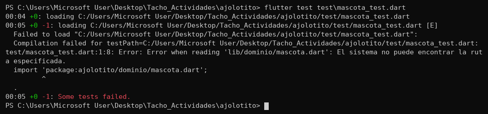

**🟢 Verde**

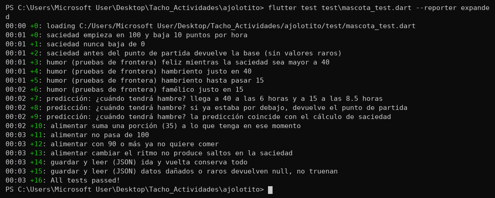

### 2. Pantalla (pruebas de widgets)
**🔴 Rojo**

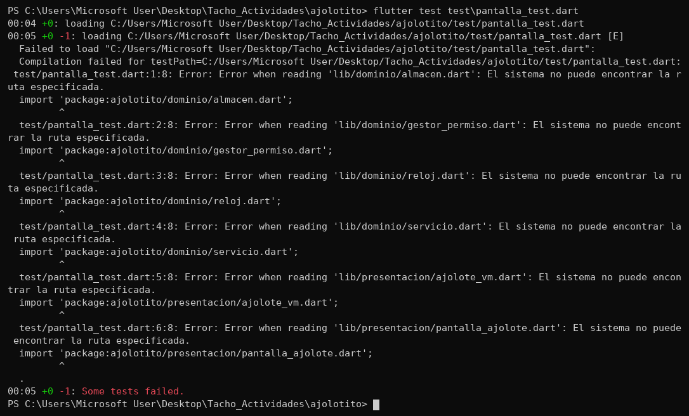

**🟢 Verde**

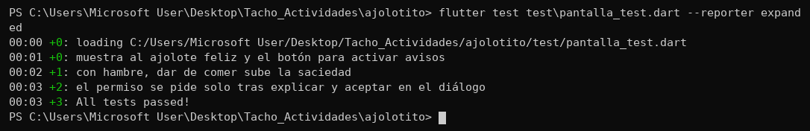

### 3. Permiso
**🔴 Rojo**

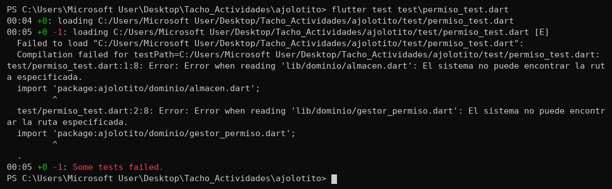

**🟢 Verde**

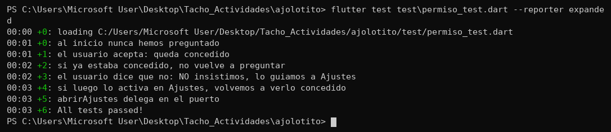

### 4. Planificador
**🔴 Rojo**

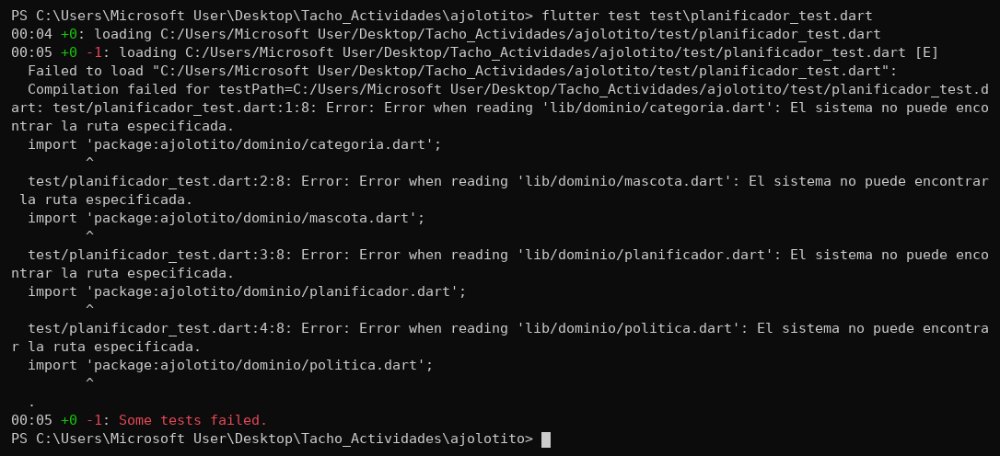

**🟢 Verde**

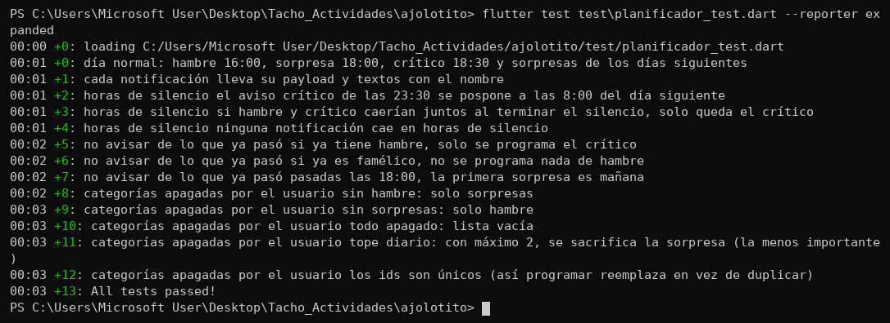

### 5. Política y payload
**🔴 Rojo**

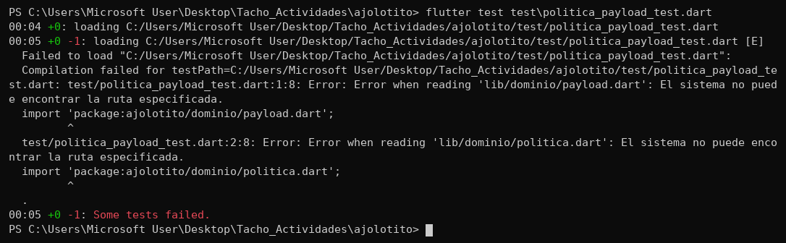

**🟢 Verde**

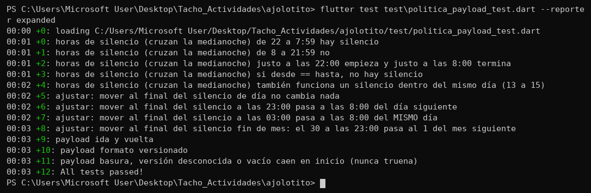

### 6. Servicio
**🔴 Rojo**

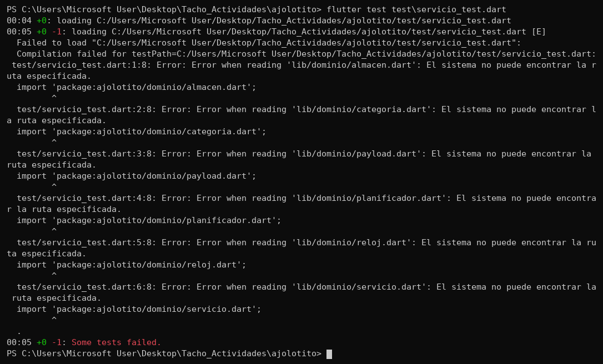

**🟢 Verde**

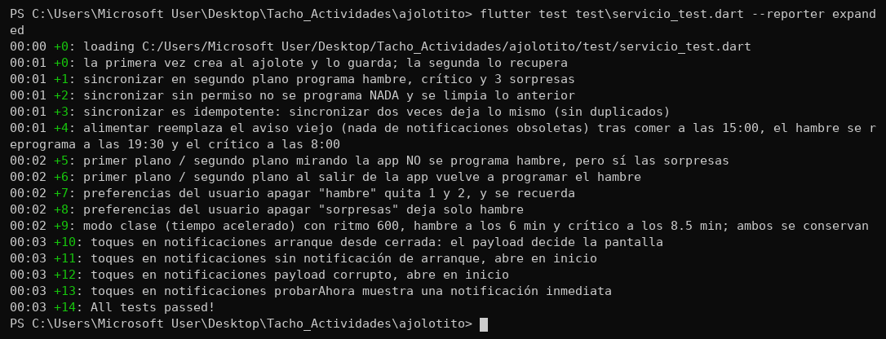

### 7. ViewModel
**🔴 Rojo**

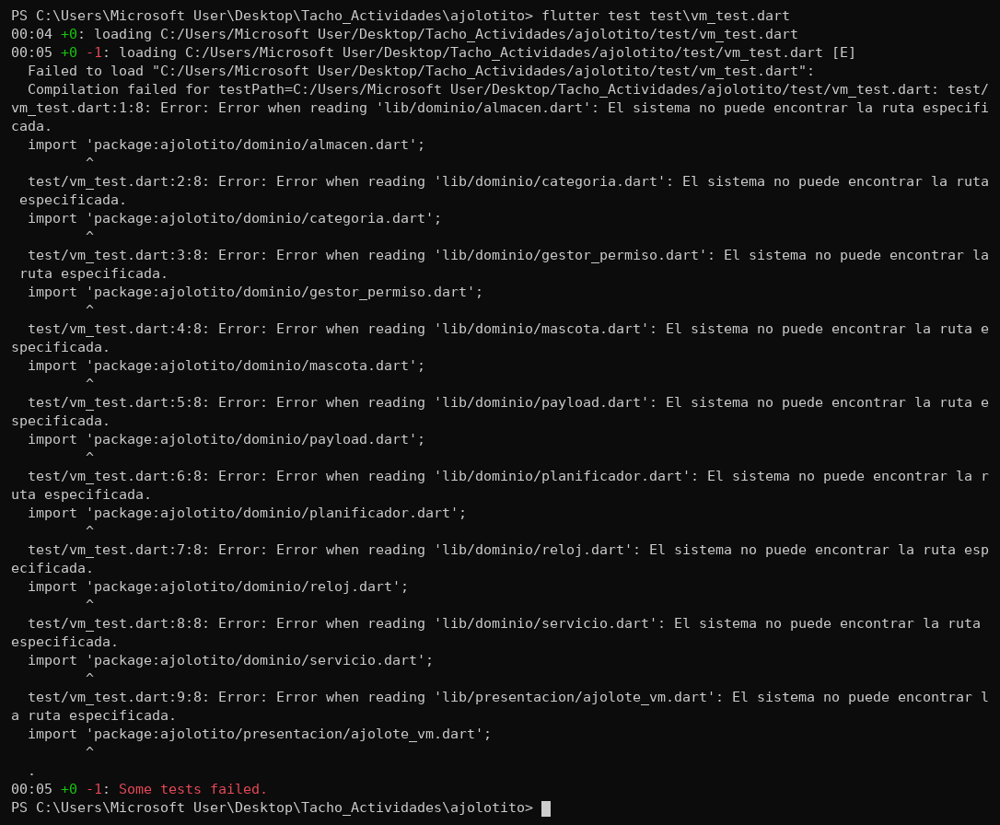

**🟢 Verde**

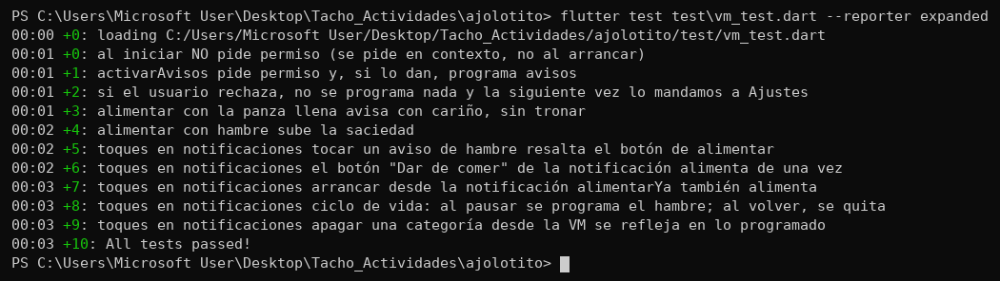

### 8. Todas las pruebas
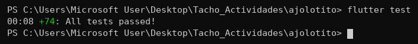

---

## Lista de verificación

- [x] `flutter test` pasa en verde (siete archivos de pruebas).
- [x] Al abrir la app por primera vez no se pide ningún permiso.
- [x] El permiso se pide tras una explicación propia y solo una vez.
- [x] Con el permiso denegado, la app sigue útil y no insiste.
- [x] Los avisos nunca caen entre 10 pm y 8 am.
- [x] Dar de comer reemplaza los avisos viejos (no quedan avisos obsoletos).
- [x] Mirando la app, no llegan avisos de hambre.
- [x] Cada tipo de aviso se puede apagar por separado.
- [x] Tocar la notificación (con la app cerrada, en segundo plano o abierta) lleva a la pantalla correcta.
- [x] Un payload corrupto abre el inicio sin tronar.
